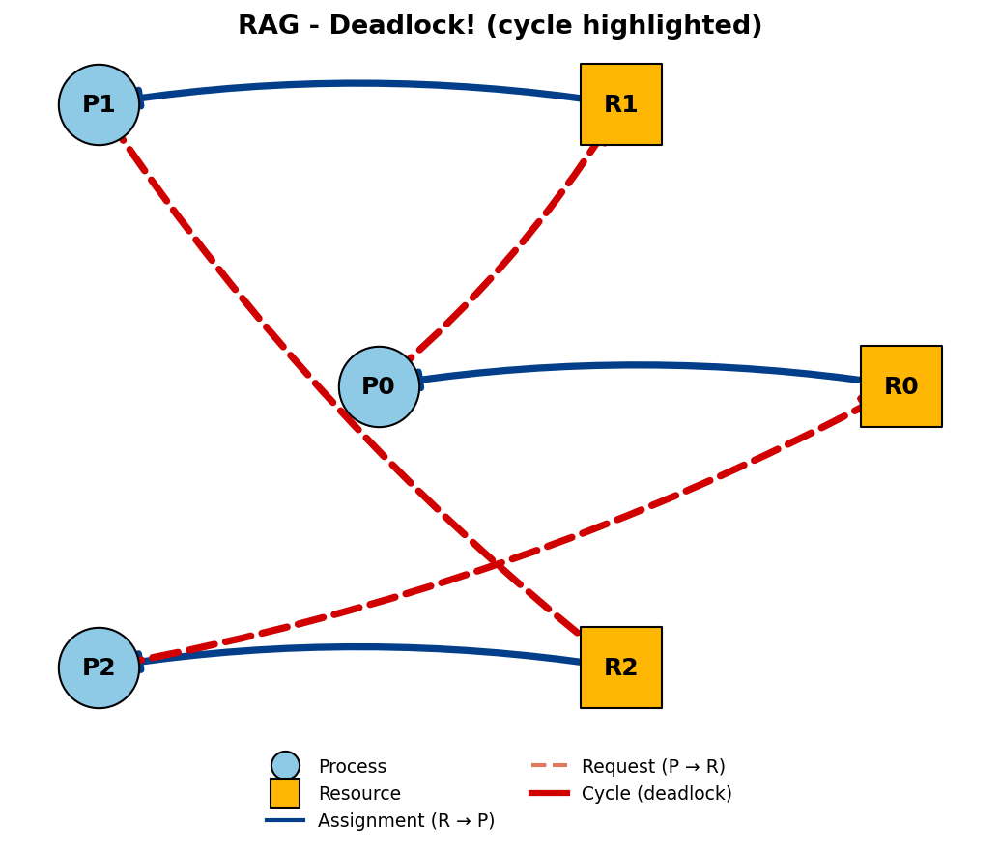
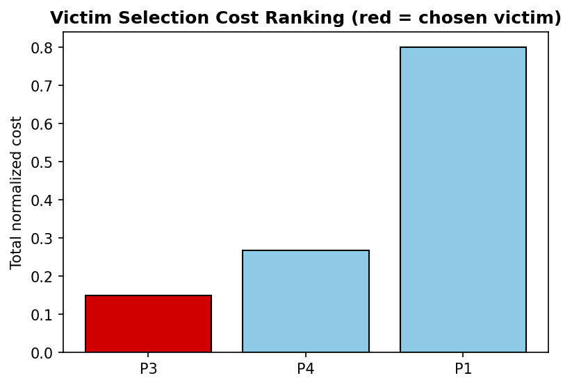

# Deadlock Guardian

**OS Resource Management, Detection & Recovery System**

A complete simulation of how an operating system reasons about deadlocks across
their full lifecycle — **avoidance → detection → recovery** — with graph
visualizations of the underlying resource state.

---

## Features

| Component | What it does | Technique |
|---|---|---|
| **Resource Allocation Graph (RAG)** | Visualizes processes, resources, and who's waiting on whom | NetworkX + Matplotlib |
| **Deadlock Avoidance** | Refuses any resource request that would leave the system unable to guarantee completion of all processes | Banker's Algorithm |
| **Deadlock Detection** | Finds deadlocks that have already occurred, for systems that don't run avoidance | Cycle detection (single-instance) + matrix reduction (multi-instance) |
| **Deadlock Recovery** | Chooses which process to abort to break a deadlock, minimizing wasted work | Cost-based victim selection |

## Why this project matters

Real operating systems rarely rely on a single deadlock strategy — Banker's
Algorithm is safe but overly conservative and needs advance knowledge of every
process's maximum resource claim (unrealistic in practice); most production
systems instead **allow deadlocks to occasionally happen** and use detection +
recovery. This project implements **both** strategies side by side so their
trade-offs are directly comparable, and adds a recovery step (victim
selection) that most course projects skip entirely.

## Project structure

```
deadlock_guardian/
├── src/
│   ├── resource_system.py    # ResourceSystem class + Banker's Algorithm
│   ├── rag.py                 # RAG construction & drawing (NetworkX/Matplotlib)
│   ├── detection.py           # Cycle detection + multi-instance detection
│   └── victim_selection.py    # Cost-based victim selection for recovery
├── notebooks/
│   └── deadlock_guardian_demo.ipynb   # Full walkthrough with live visualizations
├── tests/
│   └── test_system.py         # Unit tests for every algorithm
├── images/                    # Saved graph outputs (generated by the notebook)
└── docs/                      # Extra write-up / report material
```

## Algorithms in detail

### 1. Banker's Algorithm (avoidance)
Given `available`, `allocation`, and `max_claim` matrices, a request is only
granted if:
1. it does not exceed the process's declared remaining **need**,
2. it does not exceed **available** resources, and
3. granting it (tentatively) leaves the system in a **safe state** — i.e.
   there still exists some order in which every process can finish.

Safety is checked by simulating processes finishing one at a time, releasing
their resources back into a `work` pool, exactly as in Silberschatz's
*Operating System Concepts*.

### 2. Deadlock Detection
- **Single-instance resources**: a deadlock exists **iff** the *wait-for
  graph* (processes only, collapsed from the RAG) contains a cycle. This is
  both a necessary and sufficient condition.
- **Multi-instance resources**: the same matrix-reduction idea as Banker's
  safety check, but run against processes' *actual current requests* rather
  than their *declared maximum claims* — because in a detection-based system,
  processes don't have to declare a maximum up front.

### 3. Cost-Based Victim Selection (recovery)
Once a set of deadlocked processes is known, the cheapest one to sacrifice is
chosen using a normalized, weighted cost function:

```
cost(P) = 0.30·cpu_time_used + 0.25·priority + 0.15·resources_held
        + 0.20·progress      + 0.05·interactive − 0.15·num_restarts
```

All factors are min-max normalized to `[0, 1]` before weighting. The
`num_restarts` term is **negative** so a process that has already been
sacrificed once becomes progressively less likely to be picked again,
preventing starvation of any single process.

## Running it

```bash
pip install networkx matplotlib jupyter

# Run the unit tests
python tests/test_system.py

# Open the full interactive demo
jupyter notebook notebooks/deadlock_guardian_demo.ipynb
```

## Sample output

**A cycle forming in the Resource Allocation Graph (deadlock):**



**Victim selection cost ranking:**



## Possible extensions (for further marks / discussion)
- Add a live "process arrival" simulator with random request generation to
  stress-test avoidance vs detection over hundreds of steps.
- Extend victim selection to support **partial preemption** (taking back only
  some of a process's resources) instead of full termination.
- Add a Tkinter/Streamlit front-end so the RAG updates live as requests are
  typed in.

## Authors / Course Info
Add your name, course code, and submission date here.
